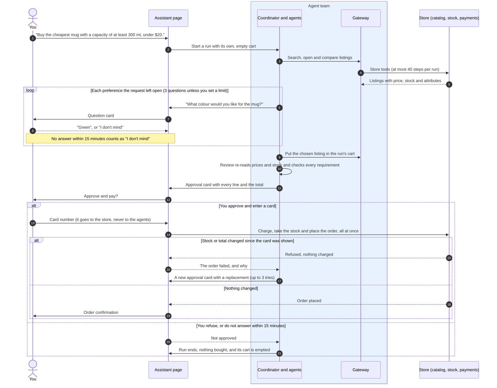

# Kyo Shop

[](https://github.com/mybelovedstar123/shopping_agent_code/actions/workflows/ci.yml)

[](https://fastapi.tiangolo.com/)
[](compose.yaml)
[](https://github.com/astral-sh/ruff)

A complete shopping application in which a team of independent AI agents can shop for you.
Browse and buy like in any online store, or describe what you want and let the agents search,
compare, ask you questions and fill a cart. **Nothing is bought until you approve the cart they
show you, and the agents never see your card number.**

It runs entirely on your own machine with no accounts or API keys. Payments are simulated, and
no real money moves.

```bash
docker compose up --build        # then open http://127.0.0.1:8000
```

Or without Docker, on Python 3.11 or newer:

```bash
pip install -e .
python -m kyo                    # seeds 144 products on first run
```

If port 8000 is taken, set `KYO_PUBLISH_PORT` for Docker, or `KYO_PORT` without it. At checkout,
use the test card `4242 4242 4242 4242`. The card `4000 0000 0000 0002` is always declined.

## Contents

- [How you and the assistant work together](#how-you-and-the-assistant-work-together)
- [Using the assistant](#using-the-assistant)
- [The agent team](#the-agent-team)
- [How a purchase stays safe](#how-a-purchase-stays-safe)
- [How well it works](#how-well-it-works)
- [The store](#the-store)
- [The original single agent](#the-original-single-agent)
- [Configuration](#configuration)
- [Project layout](#project-layout)
- [Development](#development)
- [Known limitations](#known-limitations)
- [More documents](#more-documents)

## How you and the assistant work together

You talk only to the assistant page. Behind it, the agent team works through the store's tools
in a cart of its own, and the purchase itself happens only when you approve and pay.



If nothing in the store meets every requirement, the run stops before the approval card, says
"Sorry, nothing in the store meets all of your requirements.", and buys nothing.

## Using the assistant

Log in, open **Assistant**, and describe what you want:

> Buy the cheapest mug with a capacity of at least 300 ml, under $20.

On the sample catalog this asks about colour, dishwasher safety and material, then offers the
Harbor Mug in orange for $10.98. A cheaper 300 ml mug exists, but it is sold out, so the
assistant passes over it.

The page shows each agent's progress as it works, and the **Full timeline** link shows every
step and tool a run used. You can also say how many questions it may ask ("ask me at most one
question", "don't ask me anything"), how many steps it may take ("within 12 steps"), and that it
should check with you in a message before it buys ("and ask me before you buy").

Without a model, requests are read by rules that understand simple wording: products, quantities,
colours, materials, measurements, budgets (a total, or per item when "each" stands next to the
amount), "cheapest", and "largest" or "smallest" with the measure to compare ("the mug with the
largest capacity"). Words it does not recognise count as requirements, so an unusual request is
more likely to end with "nothing fits" than with a wrong purchase. To give the agents a model's
judgement, see [Configuration](#configuration).

## The agent team

Agents share no memory. Each has its own mailbox and worker, and they exchange only JSON messages,
so any agent can also run in its own process, and one agent failing does not stop the others.

| Agent | Job | With a model |
|---|---|---|
| `coordinator` | Runs the workflow by asking the others for results | |
| `request` | Turns the shopper's words into a structured brief | Reads the request |
| `gateway` | The only door to the store: counts steps, enforces step limits and validates arguments | |
| `catalog` | Searches, pages, opens and remembers listings, learning the store's format | Reads unusual result layouts |
| `interview` | Asks about preferences the request left unstated, and reads budgets in answers | Plans questions, reads answers |
| `selection` | Chooses a listing for each item, and says why others failed | |
| `cart` | The only agent that changes the cart, and checks the store's cart after each change | |
| `review` | Independently judges carts before checkout and declines before they end | Gives a second opinion |
| `process` | Carries out steps the request demands at the order or the ending, such as asking for approval. It cannot change the cart or check out | Decides what each step needs |
| `notes` | Reads free text in store replies for changed budgets, requirements, prices and stock | Reads notes |

A model is always optional, and each agent spends from its own call allowance within a team limit.
If a model fails, runs out or replies with something malformed, the agent falls back to its
rules. A store error becomes an error the team can act on, not the end of the run. The review
agent reports what became of the model's opinion: `passed`, `failed`, `unavailable` or `none`.

The team can also be used on its own, against any store with tools:

```python
from kyo.scenarios.store import Product, ScenarioStore
from kyo.team import run_team

store = ScenarioStore([Product("L1", "Desk lamp", "Desk Lamps", 20.0, {"colour": "red"})])
result = run_team("Buy a red desk lamp.", store)
print(result["outcome"], result["lines"], result["total"])  # purchased {'L1': 1} 20.0
```

See [docs/ARCHITECTURE.md](docs/ARCHITECTURE.md) for the design.

## How a purchase stays safe

- **Approval places the order.** The agents' `checkout` tool only asks. The shopper's own approval
  charges the card and creates the order, and it is refused if the cart's total has changed
  since the approval card was shown. An approval that arrives after the run stopped waiting is
  refused and charges nothing.
- **Agents never see card numbers.** Anything shaped like a card number, however its digits are
  spaced, is also scrubbed from stored requests, answers and logs, and only the last four digits
  of a payment are kept.
- **Each run has its own cart,** so an agent can never buy what is in the shopper's own cart.
- **Checkout is atomic.** The charge, stock reduction and order happen together or not at all.
  Concurrent checkouts cannot oversell, and a repeated request with the same `Idempotency-Key`
  cannot buy twice.
- **Every item gets the quantity asked for.** Two requested items get two lines, or one line
  holding both quantities when only one listing fits both.
- **The review agent re-checks everything** from freshly read listing records before checkout,
  trusting no other agent's conclusion.
- **It declines rather than guess.** A requirement it cannot check, or a "largest" or "smallest"
  pick whose measure no listing states, ends without a purchase.
- **Web protections:** scrypt password hashes, revocable sessions, CSRF tokens, a content security
  policy, and login throttling.

## How well it works

`python -m kyo.evaluate` runs the team through 36 shopping scenarios with no model. Currently it
passes all 30 core scenarios and 3 of 6 harder ones, and makes **no wrong purchases**. The 3
failures are safe declines. A wrong purchase in any scenario fails the test suite.

These scenarios were written alongside the code and show that the workflow behaves as designed,
not how well it shops in general. No live model has been evaluated. See
[docs/EVALUATION.md](docs/EVALUATION.md) for the results and what they do not prove.

## The store

Accounts, a catalog of 144 sample products in 9 categories with search and filters, carts, orders
and simulated payments, all available in the browser and through a JSON API.

| Endpoint | Purpose |
|---|---|
| `GET /api/products`, `/api/products/{sku}`, `/api/categories` | Search and read the catalog |
| `POST /api/register`, `/api/login`, `/api/logout` | Accounts |
| `GET /api/cart`, `PUT` and `DELETE /api/cart/{sku}` | The shopper's cart. `PUT` sets a line's quantity, and each line carries a stock `warning` |
| `POST /api/checkout`, `GET /api/orders` | Buying, with an optional `Idempotency-Key` header and an optional `expected_total_cents` that refuses a changed total |
| `POST /api/runs`, `GET /api/runs/{id}` | Start and follow an assistant run |
| `POST /api/runs/{id}/questions/{q}/answer` and `/decision` | Answer it, and approve or refuse |

Interactive API documentation is at `/docs`.

## The original single agent

[`agent.py`](agent.py) is the single agent this project grew from, kept as a standalone agent
for an external store harness. It is one conversational model with guarded tools: it reads the
request into a brief, searches each item and reads listings before the model's first turn,
interviews the shopper, and checks every checkout against the requirements. It plans each
episode to end inside the harness's 300 second limit and recovers from errors along the way.

It learns that a listing it carted has sold out in one of three ways: it re-reads the carted
listings before checking out, a refused checkout tells it the line is gone, or the store says so
in a reply. A judge then proposes replacements from the listings it has read, and the model fixes
the cart and checks out again. A checkout holding a listing the store shows as sold out is held
back, with a reminder to replace the line.

The rest of the repository does not import it, and the agent team has not taken over its newer
changes. See [docs/BASELINE_AGENT.md](docs/BASELINE_AGENT.md) for how it works and how to run it.

## Configuration

Everything is set through environment variables. `docker compose` passes these settings into
the container, apart from `KYO_DATABASE_URL`, `KYO_HOST` and `KYO_PORT`, which the image fixes so
that the data stays in the `/data` volume.

| Setting | Default | Meaning |
|---|---|---|
| `KYO_DATABASE_URL` | Local SQLite file | Where the store keeps its data |
| `KYO_HOST`, `KYO_PORT` | `127.0.0.1`, `8000` | Where `python -m kyo` listens |
| `KYO_PUBLISH_PORT` | `8000` | The port `docker compose` publishes on this machine |
| `KYO_SEED` | `1` | Set to `0` to skip adding the sample catalog |
| `KYO_SECURE_COOKIES` | `0` | Set to `1` when serving over HTTPS |
| `KYO_LOG_LEVEL` | `INFO` | Level of the JSON logs written to stderr |
| `KYO_MODEL_BASE_URL`, `KYO_MODEL_NAME`, `KYO_MODEL_API_KEY` | Unset | An OpenAI-compatible model for the agents. Without one, they use rules |

## Project layout

| Path | Contents |
|---|---|
| `kyo/runtime/` | Messages, the bus, the trace, and running an agent in its own process |
| `kyo/models/` | The model interface, budgets, the HTTP client and a scripted test model |
| `kyo/agents/` | The agents |
| `kyo/team.py` | Assembles a team and runs a request |
| `kyo/fit.py`, `kyo/schema.py`, `kyo/compat.py` | Requirement rules, tool-schema checks and part compatibility |
| `kyo/store/` | Database, services, the agents' tools and background runs |
| `kyo/api/`, `kyo/web/` | The JSON API and the shopper-facing pages |
| `kyo/scenarios/`, `kyo/evaluate.py` | The scenario store and the evaluation |
| `agent.py` | The original single agent, maintained on its own |

## Development

```bash
pip install -e ".[dev]"
ruff check .
pytest
python -m kyo.evaluate --out docs/EVALUATION.md    # a test checks this report is up to date
```

CI runs lint and tests on every pull request and on pushes to `main`, and builds the Docker image
and checks that it answers. `scripts/browser_check.py` walks through the application in a real
browser and saves screenshots. It needs Selenium and Chrome, and is run by hand.

## Known limitations

- **No live model has been tested.** The model paths have only been run with scripted replies.
- **The rule parser handles simple wording only.** A request that describes a use rather than a
  product ("something to drink my coffee from") ends with nothing bought.
- **Requirements pointing at another listing** ("the same colour as the Harbor mug") are declined,
  not followed. `agent.py` can follow them, and the team cannot yet.
- **Steps due before choosing are not carried out.** The team performs steps a request asks for
  at the order or the ending, such as asking for approval, but not ones meant to happen before it
  chooses ("check with me which brand first").
- **Part compatibility** ("a battery that fits it") needs a model to read the request.
- **Approval compares the total.** A changed total refuses the order, but a different cart with
  the same total would not be noticed. Nothing changes the run's cart while its approval card
  is waiting.
- **An `Idempotency-Key` names one purchase.** Reusing a key with a different cart returns the
  first order and does not buy the new cart.
- **A failed cart change rules a listing out** for the rest of the run, even when the failure
  was temporary.
- **The team has not been compared with `agent.py`,** which needs a live model and its original
  test environment.
- **Runs do not survive a restart.** They run on threads in the web process and are marked as
  failed when the server starts again.
- **A demonstration store.** Payments are simulated, emails are not verified, and there is no
  password reset, returns process or administration page. Before any real use, serve it over HTTPS
  with `KYO_SECURE_COOKIES=1`, and run one web process: the login throttle lives in memory.
- **SQLite by default.** The code avoids SQLite-only features, but it has only been run on SQLite.

## More documents

- [docs/ARCHITECTURE.md](docs/ARCHITECTURE.md): the design, and what the team does not do yet
- [docs/EVALUATION.md](docs/EVALUATION.md): evaluation results and their limits
- [docs/ROADMAP.md](docs/ROADMAP.md): how the project was scheduled
- [docs/BASELINE_AGENT.md](docs/BASELINE_AGENT.md): the original single agent in `agent.py`
- [CHANGELOG.md](CHANGELOG.md): what changed
